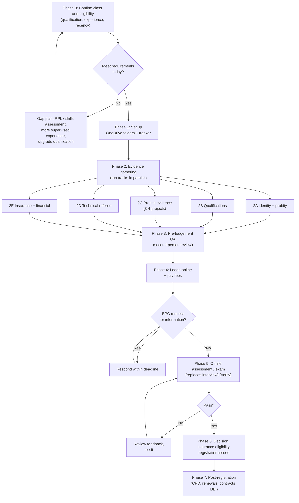

# 01 – Workflow

## Process map

## Phases

| Phase | Goal | Gate to exit | Indicative time |
|---|---|---|---|
| 0 Eligibility | Confirm you meet qualification, experience and recency rules for DB-U | Written eligibility self-assessment against the BPC page, saved with date | 1 week |
| 1 Set-up | Folder tree, tracker, document register in place | OneDrive structure created; tracker populated | 1 day |
| 2A Identity and probity | Identity, name-change, criminal history, bankruptcy/insolvency, declarations | All certified/dated within validity window | 2–4 weeks (checks have lead times) |
| 2B Qualifications | Certificates, transcripts, any RPL outcome | Certified copies saved | 1–3 weeks (longer if RPL) |
| 2C Project evidence | 3–4 projects with proof of *your* role and responsibility | Each project passes the one-page template check | 4–8 weeks (the long pole) |
| 2D Technical referee | Referee engaged, briefed, report returned | Signed report received and checked for consistency with 2C | 3–6 weeks (depends on referee) |
| 2E Insurance and financial | Domestic building insurance eligibility path understood; financial position evidenced | Written confirmation or documented path | 2–4 weeks |
| 3 QA | Independent read-through of the whole pack | Zero open items in checklist | 3–5 days |
| 4 Lodge | Submit online, pay, record receipt | Confirmation saved | 1 day |
| 5 Assessment | Sit the online exam | Result letter saved | Booking dependent |
| 6 Decision | Registration certificate issued | Certificate saved; conditions noted | Processing dependent |
| 7 Post | Insurance, CPD, contracts, renewals | Renewal date in calendar | Ongoing |

Indicative times are planning assumptions, not BPC service standards. **[Guessing]** Realistic
end-to-end: roughly **3–5 months** from today, driven by project evidence and the referee.

## Critical path

Project evidence (2C) → technical referee (2D) → QA (3) → lodge (4). Start both on day one. The referee
cannot sign off projects you have not documented, so finish 2C drafts before the formal referee request.

## Decision rules

1. **Do not lodge** until Phase 3 has no open items. A deficient lodgement costs time and may need re-lodgement.
2. **Consistency beats volume.** Dates, addresses, values and roles must match across the application form,
   your project write-ups, supporting documents and the referee report.
3. **Everything dated.** Name every file with an ISO date prefix so versions are unambiguous.
4. **Evidence of your role, not the company's.** Contracts and permits often name the employer or builder of
   record. Add letters, variations, site diaries, emails or invoices that show *you* made the decisions.
5. **No trading as a registered builder before registration is issued.** Do not sign domestic building
   contracts for work needing registration in your own name until registration is granted. **[Verify scope with BPC]**
